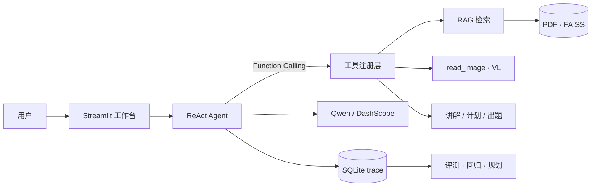

# 智能学习助手 · Study Assistant

> 面向自主学习场景的 AI 学习代理：把教材、练习、错题和复习计划连成一条闭环，而不是只回答一次问题。


**仓库地址：** [https://github.com/433110535/study-assistant](https://github.com/433110535/study-assistant)

---

## 目录

- [为什么做这个项目](#为什么做这个项目)
- [核心能力](#核心能力)
- [系统架构](#系统架构)
- [技术栈](#技术栈)
- [快速开始](#快速开始)
- [项目结构](#项目结构)
- [设计与工程原则](#设计与工程原则)
- [质量与评测](#质量与评测)
- [路线图](#路线图)
- [参与与反馈](#参与与反馈)
- [许可](#许可)

---

## 为什么做这个项目

通用聊天机器人能讲知识，但它不知道三件关键的事：

1. **你手上是什么教材**——回答往往脱离你正在学的资料。
2. **你错在哪里**——没有错题记录，就无法针对性补强。
3. **你学到哪一步**——没有学习档案，计划与复习只能靠感觉。

本项目把 **RAG 检索、工具调用、运行 trace、学习记录与评测** 放在同一条链路上：

```text
上传教材 → 检索依据 → 讲解/出题 → （规划）批改 → 错题归因 → 到期复习
```

目标不是做一个“什么都能聊”的机器人，而是一个能持续跟进、可被验证的学习代理。详细设计见 [`说明/功能扩展设想.md`](说明/功能扩展设想.md)。

---

## 核心能力

### 已实现

- **ReAct 多步问答**：模型自主选择工具，流式输出，思维链可展开查看。
- **个人知识库**：PDF → 切分 → 向量化 → FAISS 检索，回答带来源与相似度。
- **学习工具集**：概念讲解、对比、学习计划、日程、出题与批改（部分页面为直接函数调用）。
- **拍照识题（初版）**：问答页上传题目图片后，先把 `read_image` 的识别文本填进修正框，改完再发送。Agent 随后可检索并分步讲解。没有 API Key 时框里是配置提示。图片仅存本地 `data/uploads/`。
- **工具注册表**：`ToolSpec` 元数据（超时、副作用、成本提示）。执行失败会按次数重试，并在连续 3 次失败后熔断 30 秒。参数错误不重试，也不计入熔断。各工具默认 `retries` 仍是 0。模型调用使用同一套退避和熔断，客户端自身不再重试。识图、飞书和邮件也走这套退避，熔断按通道分开。
- **运行 trace（SQLite）**：每次问答 run 与 tool_call 写入 `data/app.db`，为评测与中台打地基。
- **问答持久化**：对话写入本机 SQLite。刷新后恢复最近一次；问答页的「历史会话」可以打开更早的记录。「开启新会话」只换一条新记录，不删除旧的。
- **错题本（待确认）**：`save_mistake` 只写入待确认记录，在「错题本」页面确认后才进入次日复习。
- **代码助教（本机沙箱）**：代码助教页可运行学生代码和 `assert` 测试。失败时按 1–3 级提示，不直接给改正后的完整代码。同一次练习的每次运行会留下，可载入某一版再改。问答里对应工具为 `run_code`、`run_tests`、`explain_traceback`、`hint_level`。当前是进程隔离，不是容器，不要暴露到公网。
- **对照标准答案批改**：习题页可在本地判分。答错后给出错因，并把题干里的数字换成变式，不附答案。没有标准答案时不判分。错题仍要在「错题本」确认。问答工具为 `grade_item`、`diagnose_error`、`make_variants`。
- **主动复习**：页面外每天北京时间 8:00 生成卡片。未配置飞书和 SMTP 时只写本地发件箱。配齐 `SMTP_HOST`、`SMTP_FROM`、`REVIEW_EMAIL_TO` 后发邮件。`python -m backend.workers.review_reply --text 推到晚上` 可改期；`--serve` 只听 127.0.0.1，不是飞书回调。
- **评测基线**：默认集 `eval/datasets/qa_baseline_v5.json` 共 100 条（v1–v4 仍保留）。`python -m backend.platform.eval_runner --dry-run` 不调用模型，会打工具选择，并对 16 条检索题用固定片段打忠实度。`--live` 才调用模型。调用了 `rag_search` 时，用当次检索正文打忠实度；没检索的题不记分。传入或算出的忠实度低于 0.85 会拦截。
- **失败归因**：侧栏「失败归因」读取最近一次 `eval_runs`。工具没选对时按缺失工具计数；检索没有正文记为检索为空；忠实度低于 0.85 记为答案不忠实；工具返回里的「执行超时」记为超时。设置 `EVAL_MAX_COST_YUAN` 后，超过该费用才记为成本超限。
- **本机 API**：`python -m backend.api` 在 `127.0.0.1:8000` 提供工具列表、trace、错题确认和复习卡片。配置 `STUDY_API_KEY` 后，`/v1` 要求 `X-API-Key`。失败归因页请求 `/v1/eval/latest`。错题页的列表、确认、丢弃、到期、改期和保存卡片都走本机 API；保存卡片不外发。问答等其余页面仍直接读 SQLite。`copy_database` 可备份并恢复这个库。

### 规划中

- 拍照批改的真实试卷验收，以及真实飞书 webhook 验收
- 代码助教的容器隔离（64MB 内存上限已有）
- 页面改走 API，以及 Postgres / MinIO。本机 FastAPI 和 SQLite 备份已有

---

## 系统架构



一次带图片的问答路径：

```text
上传图片 → 消息含本地路径
  → read_image 识题
  → rag_search（按需）
  → 分步讲解 + 变式题
  → trace 落库
```

---

## 技术栈

| 类别 | 选型 | 说明 |
|---|---|---|
| 语言 | Python 3.11+ | 后端与前端同语言 |
| 界面 | Streamlit | 多页面工作台 |
| Agent | LangChain 1.7 + 自研 ReAct | `langchain-core` / `langchain-openai`，流式与工具可视化 |
| 大模型 | Qwen-Max（DashScope） | Function Calling |
| 视觉 | Qwen-VL（`VISION_MODEL`） | 题目识图 |
| 向量检索 | FAISS + DashScope Embedding | 本地索引 |
| 持久化 | SQLite（`data/app.db`） | run / tool_call trace |
| 评测 | 自建 runner + 工具选择门禁 | 100 条基线；离线检索题打忠实度 |

---

## 快速开始

```bash
git clone https://github.com/433110535/study-assistant.git
cd study-assistant

python -m venv venv
# Windows
venv\Scripts\activate
# macOS / Linux
# source venv/bin/activate

pip install -r requirements.txt
```

配置环境变量：

```bash
# Windows
copy .env.example .env
# macOS / Linux
cp .env.example .env
```

在 `.env` 中填入 DashScope API Key（文本与识图共用）：

```dotenv
DASHSCOPE_API_KEY=sk-xxxxxxxxxxxxxxxx
LLM_MODEL=qwen-max
VISION_MODEL=qwen-vl-max
```

启动：

```bash
python start.py
# 或
streamlit run frontend/app.py
```

浏览器访问 `http://localhost:8501`。在 **在线问答** 页可上传题目图片进行识题讲解。

### 测试（不调用 LLM）

```bash
python -m unittest discover -s tests -v
python -m backend.platform.eval_runner --dry-run
```

---

## 项目结构

```text
study-assistant/
├── backend/
│   ├── agents/          # ReAct、工具注册表、事件模型
│   ├── tools/             # 讲解、计划、出题、vision.py、code_sandbox.py
│   ├── knowledge/         # PDF、FAISS
│   ├── platform/          # trace_store（SQLite）
│   ├── config.py
│   └── llm_helper.py
├── frontend/
│   └── app.py             # Streamlit 工作台
├── tests/
├── data/                  # 索引、上传、app.db（默认不入库）
├── 说明/                  # 功能扩展设想等
├── requirements.txt
└── README.md
```

---

## 设计与工程原则

1. **Agent 决策，而非关键词匹配**  
2. **工具是一等公民**：超时、错误字符串返回、trace 记录  
3. **写操作需确认**（后续日历、消息、错题本）  
4. **回答可追溯**：RAG 带来源；run 可落库  
5. **评测先于大规模功能堆叠**  
6. **不堆假功能页**：新能力必须新增真实动作轴  

---

## 质量与评测

目标值（随评测中台逐步启用）：

| 维度 | 指标 | 目标 |
|---|---|---|
| 检索 | hit@3 | ≥ 0.85 |
| 生成 | 忠实度 | ≥ 0.85 |
| Agent | 工具选择准确率 | ≥ 90% |
| 工程 | trace 覆盖率 | 100% |

---

## 路线图

| 阶段 | 内容 | 状态 |
|---|---|---|
| P0 | 开源仓库、README、架构文档 | 已完成 |
| P1 | 工具注册表、SQLite trace、拍照识题初版 | 初步完成 |
| P2 | 错题本 + 拍照批改闭环 | 对照判分和整卷拆题已有，真实试卷未验收 |
| P3 | 代码执行助教 | 本机沙箱有超时和 64MB 内存上限，无容器 |
| P4 | 主动复习与推送 | 每日调度、本地发件箱和可选 SMTP 已有，真实飞书未验收 |
| P5 | 评测 runner、门禁、失败归因页、FastAPI 服务化 | 本机 API 和 SQLite 备份已有，页面仍直连数据库 |

---

## 参与与反馈

欢迎 Issue / PR。较大改动请先对照 `说明/功能扩展设想.md` 讨论优先级。

---

## 许可

MIT License（如需正式 LICENSE 文件可在 Issue 中提出）。
