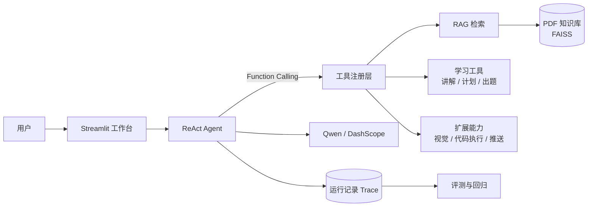

# 智能学习助手 · Study Assistant

> 面向自主学习场景的 AI 学习代理：把教材、练习、错题和复习计划连成一条闭环，而不是只回答一次问题。


> **仓库状态**
> 代码正在按产品化标准重构，当前仓库仅包含 README 与路线图，暂不提供源码。
> 重构完成后会按阶段开放；在此之前不接受代码 PR，欢迎通过 Issue 讨论设计与需求。

---

## 目录

- [为什么做这个项目](#为什么做这个项目)
- [核心能力](#核心能力)
- [系统架构](#系统架构)
- [技术栈](#技术栈)
- [快速开始](#快速开始)
- [项目结构](#项目结构)
- [设计与工程原则](#设计与工程原则)
- [质量与评测](#质量与评测)
- [路线图](#路线图)
- [参与与反馈](#参与与反馈)
- [许可](#许可)

---

## 为什么做这个项目

通用聊天机器人能讲知识，但它不知道三件关键的事：

1. **你手上是什么教材**——回答往往脱离你正在学的资料。
2. **你错在哪里**——没有错题记录，就无法针对性补强。
3. **你学到哪一步**——没有学习档案，计划与复习只能靠感觉。

本项目把 **RAG 检索、工具调用、学习记录与评测**放在同一条链路上：

```text
上传教材 → 检索依据 → 讲解/出题 → 批改 → 错题归因 → 到期复习
```

目标不是做一个“什么都能聊”的机器人，而是一个能持续跟进、可被验证的学习代理。

---

## 核心能力

### 当前本地版本已具备

- **ReAct 多步问答**：模型自主判断是否需要工具、调用哪个工具，并在拿到结果后继续推理。
- **个人知识库**：上传 PDF → 文本切分 → 向量化 → FAISS 检索，回答带来源与相似度。
- **学习工具集**：概念讲解、概念对比、学习计划、每日日程、出题与批改。
- **思维链可视化**：展示工具选择、参数、返回结果与最终回答，推理过程可解释。
- **多页面工作台**：数据看板、在线问答、思维链、知识讲解、概念对比、学习计划、日程、习题、向量知识库。

### 规划中

- **拍照识题与批改闭环**：识图 → 判分 → 错因归类 → 回查教材 → 生成变式题 → 写入错题本。
- **代码执行助教**：真实运行测试，读取报错，按提示级别引导修改，直到通过。
- **主动复习**：基于 SM-2 计算到期知识点，后台定时生成复习卡片并推送。
- **数据中台与评测中台**：统一 trace、数据集版本、离线评测、发布门禁与线上监控。

---

## 系统架构



一次问答的路径：

```text
用户输入
  → Agent 组装系统提示、工具定义与上下文
  → LLM 决定直接回答或调用工具
  → 执行工具，结果回填
  → LLM 判断是否足够，不够继续调用
  → 输出最终回答，并记录完整调用链
```

---

## 技术栈

| 类别 | 选型 | 说明 |
|---|---|---|
| 语言 | Python 3.12 | 后端与前端同语言 |
| 界面 | Streamlit | 快速构建数据密集型工作台 |
| Agent | LangChain + 自研 ReAct 循环 | 保留完整控制权，便于流式输出与可视化 |
| 大模型 | Qwen-Max（DashScope） | OpenAI 兼容接口，支持 Function Calling |
| 向量化 | DashScope TextEmbedding | 中文语义检索 |
| 向量检索 | FAISS | 本地、轻量、可持久化 |
| 文档解析 | pypdf | PDF 文本提取 |
| 数据存储 | SQLite（规划） | 会话、错题、掌握度、trace |
| 评测 | 自研 Runner + Ragas / promptfoo（规划） | 离线回归与发布门禁 |
| 部署 | Docker Compose（规划） | API、Worker、数据库、对象存储 |

---

## 快速开始

> 以下命令在源码开放后可用；当前仓库仅包含 README。

```bash
git clone <repository-url>
cd study-assistant

python -m venv venv
# Windows
venv\Scripts\activate
# macOS / Linux
# source venv/bin/activate

pip install -r requirements.txt
```

配置环境变量：

```bash
# Windows
copy .env.example .env
# macOS / Linux
cp .env.example .env
```

在 `.env` 中填入 DashScope API Key：

```dotenv
DASHSCOPE_API_KEY=sk-xxxxxxxxxxxxxxxx
LLM_MODEL=qwen-max
```

启动：

```bash
streamlit run frontend/app.py
```

浏览器访问 `http://localhost:8501`。

---

## 项目结构

```text
study-assistant/
├── backend/
│   ├── agents/          # ReAct 循环、工具注册、事件模型
│   ├── tools/           # 讲解、计划、出题、RAG、视觉、代码执行
│   ├── knowledge/       # PDF 解析、切分、向量化、FAISS
│   ├── platform/        # trace、数据集、评测、指标（规划）
│   ├── config.py        # 配置与密钥读取
│   └── llm_helper.py    # LLM 实例
├── frontend/
│   └── app.py           # Streamlit 工作台
├── tests/               # 单元测试与评测集
├── data/                # 本地索引与上传文件（不入库）
├── 说明/                # 设计文档、路线图与实现说明
├── requirements.txt
└── README.md
```

---

## 设计与工程原则

1. **Agent 决策，而非关键词匹配**：工具选择由模型根据语义判断，代码只负责执行与约束。
2. **工具是一等公民**：每个工具都有明确的输入输出、超时、错误处理与成本记录；写操作默认需要确认。
3. **回答可追溯**：检索结果带来源与相似度，回答尽量引用命中的文档片段。
4. **数据可删除**：PII 脱敏、保留期、导出与删除是产品能力，不是补丁。
5. **评测先于发布**：工具选择、检索命中、答案忠实度、学习增益都要有基线，改坏了要能拦住。
6. **不追求功能数量**：优先做能形成闭环的能力，而不是继续堆 prompt 页面。

---

## 质量与评测

以下为目标值，随评测中台落地逐步启用：

| 维度 | 指标 | 目标 |
|---|---|---|
| 检索 | hit@3 / MRR | hit@3 ≥ 0.85 |
| 生成 | 忠实度 / 引用有效性 | 忠实度 ≥ 0.85，引用有效 100% |
| Agent | 工具选择准确率 / 平均迭代 | ≥ 90% / ≤ 2.5 轮 |
| 安全 | 注入成功率 / PII 泄漏 | ≤ 5% / 0 |
| 学习效果 | 前测后测增益 / 错题复现率 | 复现率下降 ≥ 20% |
| 工程 | trace 覆盖率 / 回滚可用 | 100% / 可一键回滚 |

---

## 路线图

| 阶段 | 内容 | 状态 |
|---|---|---|
| P0 | 仓库与文档、架构梳理 | 进行中 |
| P1 | 持久化、工具注册表、运行 trace | 规划中 |
| P2 | 拍照识题与批改、错题本 | 规划中 |
| P3 | 代码执行助教 | 规划中 |
| P4 | 主动复习与推送 | 规划中 |
| P5 | 数据中台、评测中台、服务化 | 规划中 |

详细设计见项目内的 `说明/功能扩展设想.md`（随源码开放）。

---

## 参与与反馈

- 当前阶段欢迎通过 **Issue** 讨论需求、场景与设计取舍。
- 源码开放前暂不接受代码 PR，避免与重构分支冲突。
- 如果你在使用类似的学习产品，欢迎描述你的工作流与痛点，这些会直接影响路线图优先级。

---

## 许可

MIT License（LICENSE 文件将随源码一并补充）。
